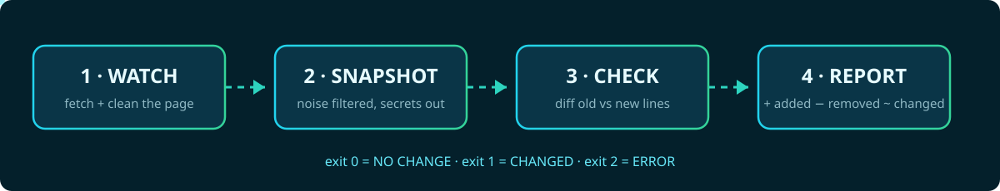

<div align="center">




<br/>

[](drift.py)
[](#-guarantees)
[](#-use-it-from-an-agent)
[](#-tests)
[](LICENSE)

</div>

An AI agent has no memory of the web. It read the docs yesterday,
the pricing page last week, the model list last session — and since
then, any of them may have changed. The agent doesn't know. It keeps
working from the old version, or it re-reads entire pages and burns
tokens hunting for the one line that moved.

`drift-cli` gives the agent a memory. Snapshot a page once with
`watch`; later, `check` fetches it again, cleans it the same way,
and reports **only what actually changed**: lines added, lines
removed, and lines that clearly evolved — shown as old → new pairs
(a price going `$20` → `$25` is a *changed pair*, not two unrelated
lines). Timestamps, session ids and other noise are filtered out
**before** the diff, so a page that only changed its clock reports
**NO CHANGE**.


## 🛡️ Guarantees

- **Noise never cries wolf.** ISO dates/times, "3 minutes ago",
  UUIDs, long hex tokens (session ids, hashes) and
  session/csrf-style query values are normalized away before
  diffing. The report counts how many lines the filter touched.
- **Prices are not noise.** Ordinary numbers and prices are never
  normalized — a price change is real drift and is always reported.
- **Secrets never reach disk.** Strings shaped like API keys
  (`sk-…`, `ghp_…`, `github_pat_…`, `AKIA…`, `xox…`, bearer tokens)
  are redacted *before* the snapshot is stored, so they cannot
  appear in any report. Query strings are stripped from URLs shown
  in reports.
- **Stdlib-only core.** No pip installs, no API keys, no services.
  One Python file.
- **Machine-checkable verdict.** `drift check` exits **0** =
  NO CHANGE, **1** = CHANGED, **2** = ERROR (fetch failed or never
  watched). An error is printed as an error — never dressed up as
  a diff.


## 🚀 Quick start

```bash
# 1. snapshot the pages you depend on
python3 drift.py watch https://api.example.com/v1/models
python3 drift.py watch https://docs.example.com/pricing

# 2. later — tomorrow, next session, from cron — ask what changed
python3 drift.py check                 # all watched pages -> drift-report.md
echo $?                                # 0 NO CHANGE · 1 CHANGED · 2 ERROR

# 3. read the report: only the changes, with the meaning attached
cat drift-report.md
```

```markdown
# drift report
Status: **CHANGED**

## https://api.example.com/v1/models
Snapshot: 2026-10-24T03:00:00+00:00 · 143 lines · noise lines filtered on this fetch: 3

### Changed
- "name": "pro", "price": "$20 / month"
+ "name": "pro", "price": "$25 / month"

### Added
+ - gpt-gamma
```

More commands:

```bash
python3 drift.py list                  # watched URLs, snapshot time, line count
python3 drift.py check <url> --json    # machine-readable verdict
python3 drift.py check <url> --out reports/today.md
python3 drift.py forget <url>          # stop watching a page
```

Snapshots live in `~/.drift-cli/` (one JSON file per URL, mode
600). Override the location with the `DRIFT_HOME` environment
variable.


## ⚙️ How it works

<div align="center">

</div>

1. **Watch** fetches the page with `urllib` and reduces it to clean
   text lines with a small stdlib HTML extractor: scripts, styles,
   nav, footer, forms and other chrome are dropped; headings keep
   their structure as `#` / `##` markdown lines. JSON endpoints are
   pretty-printed and diffed line by line too.
2. **Snapshot** stores those lines — after redaction and noise
   normalization — plus a SHA-256 of the joined text.
3. **Check** re-fetches, cleans identically, and diffs with
   `difflib`. Removed+added line pairs with ≥ 0.8 similarity are
   presented as **Changed** pairs; the rest are plain **Added** /
   **Removed**.
4. **Report** is one markdown file an agent (or a human) can read
   in seconds — plus an exit code a script can trust.


## 🤖 Use it from an agent

`drift mcp` runs a stdio MCP server with two tools:

| Tool | Input | Returns |
|---|---|---|
| `drift_watch` | `{url}` | snapshot summary (lines stored, noise filtered) |
| `drift_check` | `{url?}` | the full drift report text (omit `url` to check all watched) |

```json
{ "command": "python3", "args": ["/path/to/drift.py", "mcp"] }
```

The agent-facing rules live in [SKILL.md](SKILL.md): when to watch,
how to read a verdict, and the honesty rules (NO CHANGE is a
verdict, not a guess; ERROR is reported as-is).


## 📋 Exit codes

| Code | Meaning |
|---|---|
| 0 | NO CHANGE — cleaned text is identical to the snapshot |
| 1 | CHANGED — see `drift-report.md` |
| 2 | ERROR — fetch failed, or the URL was never watched |


## 🧪 Tests

```bash
python3 -m unittest discover -s tests -v   # 7/7 passing
```

The suite serves fixture pages from a local `http.server` and
plants changes between watch and check: an unchanged page, an added
line (a new model in a list), an edited line (price $20 → $25,
asserted as a Changed pair), a noise-only change (new timestamp +
new session id + "7 minutes ago" — must stay NO CHANGE), a page
whose fake API key rotates (the secret must appear in **no**
snapshot and **no** report), list/forget behaviour, and an MCP
stdio smoke test (initialize + tools/list + watch + check).

Real-page evidence — watch + immediate check against RelayModels,
a Next.js docs page, and keyscope.funapp.live — is kept in
[`examples/`](examples/).


## ⚠️ Limitations (honest)

- **Static HTML only.** No JavaScript rendering: a page that builds
  its content in the browser may snapshot as nearly empty. The line
  count in `drift watch` output makes that visible — distrust a
  suspiciously small snapshot.
- **Line-based diff.** A wholesale page restructure shows up as
  many added/removed lines rather than a tidy summary; the Changed
  pairing threshold (similarity ≥ 0.8) is a heuristic.
- **Per-visitor unique content** that isn't date/uuid/hex-shaped
  noise (rotating headlines, A/B variants) will report CHANGED
  every time. Watch pages that are meant to be stable.
- **Bot-mitigation edges can refuse stdlib TLS clients.** Observed
  live while testing: one real site answered Python's `urllib`
  with a 200 and then closed the body at 16 KB of 30 KB, while
  serving curl the full page. drift-cli reports that as ERROR
  (exit 2) — a partial page is never snapshotted, because it would
  fake a diff on every later check.
- **No scheduler built in.** Run `check` from cron, a CI job, or an
  agent's morning pass.
- The MCP `drift_check` tool returns the report text; it does not
  write `drift-report.md` (the CLI command does).


## 📄 License

MIT — see [LICENSE](LICENSE). Part of the Funapp agent-tools
family alongside watch-cli, triage-cli, proof-cli and replay-cli:
small stdlib tools that give AI agents the senses and the memory
they don't ship with.

<div align="center">

</div>
